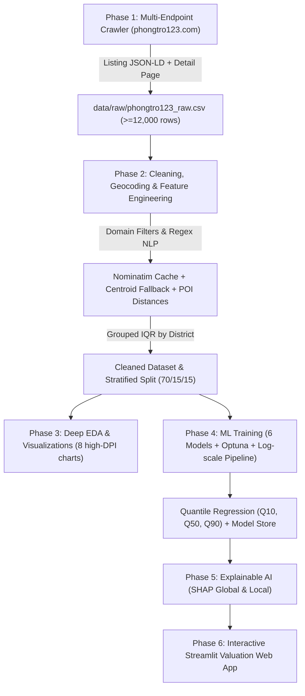

# MASTER SPECIFICATION & EXECUTION PIPELINE (`ANTIGRAVITY_SPEC.md`)
## Đề tài: Hệ Thống Thu Thập Dữ Liệu Địa Phương & Định Giá Thuê Phòng Trọ Sinh Viên Tại TP.HCM (End-to-End ML Pipeline & Explainable AI)

---

## 1. PHẠM VI HÀNH CHÍNH & TIÊU CHÍ ĐẶC TRƯNG MỚI (CHỐT 100%)

### 1.1. Phạm vi Địa lý & Hành chính
1. **Phạm vi không gian:** Toàn bộ khu vực **TP.HCM cũ** (gồm 24 khu vực quận/huyện cũ, tương ứng **102 phường/xã mới** sau sắp xếp theo Nghị quyết 1685/NQ-UBTVQH15). Tuyệt đối **không** lấy dữ liệu từ địa giới Bình Dương và Bà Rịa - Vũng Tàu cũ.
2. **Khóa địa lý định danh (Primary Geographic Unit):** Biến `ward_new` (Tên phường mới chuẩn hóa, ví dụ: `Phường Bến Thành`, `Phường Diên Hồng`, `Phường Gia Định`...).
3. **Khóa tham chiếu quận cũ (Reference / Stratification Key):** Biến `old_district` (Quận 1, 3, 5, 10, Gò Vấp, Bình Thạnh, TP. Thủ Đức...). Dùng để:
   - Cào dữ liệu theo từng endpoint quận trên web `phongtro123.com`.
   - Phân tầng dữ liệu (`Stratified Split`) chống mất cân bằng mẫu ở các vùng ngoại thành.
   - Tính toán ngưỡng lọc ngoại lai Grouped IQR do cỡ mẫu cấp quận đủ lớn để ước lượng phân phối tin cậy.
4. **Bảng ánh xạ tham chiếu (Ground-truth Mapping):** Lưu trữ tại `data/reference/ward_mapping_hcm.csv` và `docs/ward_mapping.md` gồm các trường:
   `ward_new`, `old_district_primary`, `old_districts_all`, `old_wards_merged`, `centroid_lat`, `centroid_lon`.

---

### 1.2. Giải pháp Tọa độ Địa lý 2 Tầng (Dual-Layer Geospatial Engine)
Sử dụng giải pháp tọa độ tự động không tốn phí, có cơ chế bộ đệm (caching) và fallback 100%:
* **Tầng 1 (Độ chính xác cao - Cấp đường/địa chỉ):**
  - Gửi truy vấn geocoding tới **Nominatim (OpenStreetMap)** với địa chỉ chuẩn hóa `f"{street_name}, {ward_new}, Hồ Chí Minh"`.
  - Cơ chế bắt buộc: Rate limit tối thiểu $1.0\text{s}$/request, lưu cache cục bộ trong `data/reference/nominatim_cache.sqlite` để không bao giờ gửi truy vấn trùng lặp.
  - Bộ lọc kiểm tra ranh giới: Chỉ chấp nhận tọa độ nếu nằm trong khung hộp tọa độ TP.HCM ($10.35^\circ \le \text{lat} \le 11.15^\circ$, $106.35^\circ \le \text{lon} \le 107.05^\circ$).
* **Tầng 2 (Độ bao phủ 100% - Fallback Cấp tâm phường):**
  - Nếu tầng 1 trả về None hoặc lỗi mạng, tự động gán tọa độ tâm hình học (`centroid_lat`, `centroid_lon`) của `ward_new` từ bảng `ward_mapping_hcm.csv`.
* **Gắn nhãn độ tin cậy:** Cột `geo_precision` nhận giá trị `"street"` hoặc `"ward_centroid"`.

---

### 1.3. Hệ thống POI Khoảng cách Địa lý (Geospatial Feature Set)
Từ tọa độ $(\text{lat}, \text{lon})$, áp dụng công thức **Haversine** tính toán các đặc trưng:
1. `dist_to_center_km`: Khoảng cách tới Chợ Bến Thành (Quận 1: $10.7725^\circ\text{N}, 106.6980^\circ\text{E}$).
2. `dist_to_sgu_km`: Khoảng cách tới Cơ sở chính Đại học Sài Gòn (273 An Dương Vương, Q5: $10.7599^\circ\text{N}, 106.6822^\circ\text{E}$).
3. `dist_nearest_uni_km`: Khoảng cách tới trường Đại học gần nhất (tính trên danh mục 25 trường ĐH lớn tại TP.HCM).
4. `n_uni_within_2km`: Số lượng trường Đại học trong bán kính 2 km (thước đo mật độ sinh viên và nhu cầu thuê phòng).
5. `dist_nearest_hospital_km` ⭐: Khoảng cách tới Bệnh viện lớn gần nhất (tính trên danh mục 20 bệnh viện trọng điểm: Chợ Rẫy, ĐH Y Dược, BV 115, Thống Nhất, Gia Định, Từ Dũ, Hùng Vương, Nhi Đồng, Nhân Dân Gia Định, Hoàn Mỹ...).
6. `n_hospitals_within_2km` ⭐: Số lượng bệnh viện trong bán kính 2 km (thước đo tiện ích an sinh và y tế xung quanh).
7. `dist_nearest_metro_km`: Khoảng cách tới ga Metro số 1 (Bến Thành - Suối Tiên) gần nhất.
8. `zone_group`: Phân nhóm khu vực (`Core_Center`, `Inner_City`, `Suburban`).

---

### 1.4. Hệ thống Tiêu chí Đánh giá Trọ Toàn Diện (Input Features)
Toàn bộ đặc trưng đưa vào mô hình phải là những biến **sinh viên có thể tự quan sát hoặc nhập vào được trên Web App**:

| Nhóm Tiêu Chí | Biến Số Học / Phân Loại | Diễn Giải & Nguồn Trích Xuất |
|---|---|---|
| **Không gian & Loại hình** | `area_m2` | Diện tích sử dụng thực tế ($8.0 \le \text{area\_m2} \le 60.0$) |
| | `room_type` | Loại phòng: `phong_tro`, `can_ho_mini`, `o_ghep_ktx_sleepbox`, `can_ho_dich_vu`, `nha_nguyen_can` |
| **Tiện nghi cơ bản** | `has_ac` | Có máy lạnh / điều hòa (Checkbox hoặc Regex mô tả) |
| | `has_mezzanine` | Có gác lửng / duplex (tăng diện tích sinh hoạt theo chiều đứng) |
| | `has_private_wc` | Có WC / nhà vệ sinh riêng khép kín |
| | `has_kitchen` | Có kệ bếp / khu vực nấu ăn riêng |
| | `has_balcony_window` | Có ban công hoặc cửa sổ thoáng khí trời |
| | `has_fridge` | Có tủ lạnh trang bị sẵn |
| | `has_washer` | Có máy giặt (riêng hoặc dùng chung) |
| | `has_elevator` | Tòa nhà có thang máy di chuyển |
| | `is_fully_furnished` | Đầy đủ nội thất (chỉ việc xách vali vào ở) |
| **An ninh & Tự do** | `no_curfew` | Giờ giấc tự do 24/7 |
| | `not_shared_owner` | Không chung chủ / lối đi riêng |
| | `has_security` | Có bảo vệ 24/24 hoặc camera / khóa cổng vân tay |
| | `has_parking_basement` | Có hầm hoặc bãi giữ xe trong nhà |
| **Chi phí ẩn & Đối tượng** | `is_all_inclusive` ⭐ | Giá trọn gói đã bao gồm điện, nước, wifi (cực kỳ quan trọng với KTX/Sleepbox) |
| | `female_only` | Phòng trọ / KTX chỉ nhận sinh viên nữ |
| **Chỉ số tổng hợp** | `amenity_score` | Tổng điểm tiện ích sinh viên = $\sum \text{tiện nghi}$ ($0 \le \text{score} \le 12$) |
| | `location_convenience` | Chỉ số thuận lợi vị trí dựa trên tổ hợp khoảng cách ĐH + Bệnh viện + Metro |

---

### 1.5. Ràng buộc Thời gian Bài đăng (Temporal Constraint: Year $\ge 2026$)
1. **Trích xuất thuộc tính thời gian (`post_date`):**
   - Crawler bắt buộc bóc tách thời gian của từng bài đăng từ thẻ `<time>` (ưu tiên thuộc tính `title` chứa ngày giờ đầy đủ dạng `"Chủ Nhật, 13:20 25/10/2026"`, hoặc text nội dung trong `.post-time` / `.post-meta` / chi tiết bài viết `Ngày đăng: dd/mm/yyyy`).
   - Cài đặt hàm chuẩn hóa `parse_post_date(date_raw: str) -> datetime`:
     * Bóc tách ngày tháng tuyệt đối dạng `dd/mm/yyyy` bằng Regex: `re.search(r"(\d{1,2})/(\d{1,2})/(\d{4})", text)`.
     * Xử lý thời gian tương đối nếu thiếu ngày tuyệt đối: `"vừa xong"`, `"hôm nay"` $\rightarrow$ gán thời gian hiện tại; `"hôm qua"` $\rightarrow$ trừ 1 ngày; `"X ngày trước"` $\rightarrow$ trừ `timedelta(days=X)`; `"X giờ trước"` $\rightarrow$ trừ `timedelta(hours=X)`.
2. **Quy tắc kiểm định cứng (Hard Filter Rule):**
   - Chỉ chấp nhận và lưu trữ các bài đăng có `post_date.year >= 2026`.
   - Toàn bộ bài đăng có `post_date.year < 2026` hoặc không thể xác định thời gian hợp lệ phải bị **LOẠI BỎ NGAY LẬP TỨC** trước khi ghi vào dữ liệu thô.
3. **Cơ chế dừng phân trang sớm (Early Stopping on Pagination):**
   - Do `phongtro123.com` mặc định sắp xếp danh sách tin theo thứ tự từ mới nhất đến cũ nhất:
   - Nếu crawler ghi nhận liên tiếp **30 bài đăng** có `post_date.year < 2026` trên cùng một danh mục / quận, hệ thống phải **TỰ ĐỘNG DỪNG (Break)** việc phân trang cho khu vực đó và chuyển ngay sang quận tiếp theo để tiết kiệm băng thông và phòng tránh rủi ro bị chặn IP.

---

## 2. KIẾN TRÚC MÃ NGUỒN & THƯ MỤC CHUẨN

```text
PricingSystem_ForStudentRental_inHCM/
├── ANTIGRAVITY_SPEC.md              # File đặc tả kỹ thuật và kế hoạch toàn diện
├── README.md                        # Tài liệu hướng dẫn sử dụng và chạy hệ thống
├── requirements.txt                 # Các thư viện Python cố định phiên bản
├── config/
│   ├── config.yaml                  # Tham số huấn luyện, ngưỡng lọc, tọa độ mốc
│   └── poi_database.yaml            # Danh sách tọa độ các trường ĐH, Bệnh viện, Ga Metro
├── data/
│   ├── raw/
│   │   └── phongtro123_raw.csv      # Dữ liệu cào thô (>= 12,000 dòng duy nhất)
│   ├── processed/
│   │   ├── cleaned_full.csv         # Dữ liệu sạch sau lọc miền & IQR ngoại lai
│   │   ├── train.csv                # Tập huấn luyện (70%)
│   │   ├── val.csv                  # Tập kiểm định (15%)
│   │   └── test.csv                 # Tập kiểm thử niêm phong (15%)
│   └── reference/
│       ├── ward_mapping_hcm.csv     # Bảng tra cứu 102 phường mới -> quận cũ & centroid
│       └── nominatim_cache.sqlite   # SQLite cache tọa độ địa chỉ
├── src/
│   ├── __init__.py
│   ├── crawler.py                   # Cào 2 tầng (Listing JSON-LD + Detail Checkbox/Text)
│   ├── preprocessor.py              # Làm sạch, geocoding Nominatim, Regex NLP, IQR
│   ├── eda.py                       # Tự động xuất 8 biểu đồ chuẩn mực 300 DPI & báo cáo MD
│   ├── trainer.py                   # Log-target Pipeline, 6 mô hình, Optuna 5-fold CV
│   └── explainer.py                 # SHAP Global/Local, Quantile bands & phân tích sai số
├── models/
│   └── v1/
│       ├── best_pipeline.joblib     # Pipeline tiền xử lý + mô hình tốt nhất (CatBoost/LGBM)
│       ├── quantile_low.joblib      # Mô hình hồi quy phân vị Q10 (Cận dưới giá rẻ)
│       ├── quantile_high.joblib     # Mô hình hồi quy phân vị Q90 (Cận trên giá đắt)
│       ├── metadata.json            # 8 MLOps artifacts theo chuẩn Chip Huyen Ch.10
│       └── leaderboard.csv          # Bảng so sánh 6 mô hình trên tập Test (VNĐ)
├── reports/
│   ├── eda_summary.md               # Báo cáo thống kê mô tả chuyên sâu
│   └── figures/                     # 11 biểu đồ PNG chất lượng cao
└── app/
    └── streamlit_app.py             # Web App định giá phòng trọ sinh viên & XAI trực quan
```

---

## 3. KẾ HOẠCH STEP-BY-STEP TỪ A ĐẾN Z



---

### GIAI ĐOẠN 1: THU THẬP DỮ LIỆU ĐA TẦNG (WEB SCRAPING $\ge 12,000$ DÒNG)
* **Thách thức:** Nếu chỉ cào trang danh sách, mô tả bị cắt ngắn $\approx 150$ ký tự khiến thuật toán NLP bỏ sót $60\%$ tiện ích thực tế, và trang web có thể chặn IP nếu gửi request dồn dập.
* **Quy trình triển khai trong `src/crawler.py`:**
  1. **Tầng 1 - Quét danh sách đa điểm (Multi-Endpoint Queue):**
     - Hàng đợi gồm 24 quận cũ (`/tinh-thanh/ho-chi-minh/quan-1` ... `/quan-thu-duc`) kết hợp 5 chuyên mục phòng ở (`cho-thue-phong-tro`, `cho-thue-can-ho-mini`, `tim-nguoi-o-ghep`, `cho-thue-can-ho-dich-vu`, `nha-cho-thue`). Bỏ qua chuyên mục mặt bằng kinh doanh.
     - Bóc tách thẻ `<script type="application/ld+json">` tại mỗi tin để lấy `url`, `name`, `priceRange` (VNĐ số chuẩn), `streetAddress` (có tên phường).
     - Bóc tách thời gian đăng bài từ thẻ `<time>` (lấy từ thuộc tính `title` hoặc text hiển thị) và gọi hàm `parse_post_date()`.
     - **Bộ đếm dừng sớm (Early Stopping on Pagination):** Nếu ghi nhận liên tiếp 30 tin đăng có `post_date.year < 2026` trên cùng 1 trang quận/danh mục, ngắt phân trang khu vực đó và chuyển sang endpoint tiếp theo.
  2. **Tầng 2 - Quét chi tiết (Detail Page Parsing):**
     - Bóc tách khối `<div class="border-bottom pb-3 mb-4">` chứa tiêu đề `Nổi bật`: trích xuất chính xác 11 tiện ích có class `icon check-circle-fill green`.
     - Lấy toàn văn đoạn văn `Thông tin mô tả` đầy đủ.
     - Bóc tách số điện thoại và băm một chiều `hashlib.sha256(phone.encode()).hexdigest()[:12]` để dùng cho nhận diện chủ trọ đăng lặp mà không vi phạm quyền riêng tư.
     - Xác nhận đối chiếu lại ngày đăng `Ngày đăng: dd/mm/yyyy` ở bảng đặc điểm tin đăng.
  3. **Lọc cứng thời gian & Cơ chế chịu lỗi (Temporal Filtering & Auto-Resume):**
     - **Hard Temporal Filter:** Chỉ ghi nhận bài đăng có `post_date.year >= 2026`. Loại bỏ ngay lập tức bài không đạt hoặc không thể xác định ngày.
     - Ghi nối (append) định kỳ mỗi 50 tin cào được xuống `data/raw/phongtro123_raw.csv`.
     - Giãn cách lịch sự `time.sleep(random.uniform(0.7, 1.5))` kèm xoay vòng danh sách `User-Agent`.
     - Kiểm tra `url` hoặc `post_id` đã có trong file thì bỏ qua không cào lại. Tiếp tục cào cho đến khi đạt tối thiểu $12,000$ tin duy nhất thỏa mãn toàn bộ điều kiện.

---

### GIAI ĐOẠN 2: LÀM SẠCH, TÍCH HỢP TỌA ĐỘ & KỸ THUẬT ĐẶC TRƯNG
Quy trình thực hiện tuần tự trong `src/preprocessor.py`:
1. **Khử trùng lặp (Deduplication):**
   - Loại bỏ trùng `url` hoặc trùng bộ ba `(hash_phone, area_m2, price_vnd)`.
2. **Chuẩn hóa giá & diện tích:**
   - Xử lý các định dạng giá tiếng Việt: `"3.5 triệu"` $\rightarrow 3,500,000$; `"800 nghìn"` $\rightarrow 800,000$; `"1tr5"` $\rightarrow 1,500,000$; `"4.500.000 đ/tháng"` $\rightarrow 4,500,000$ (không nhân thêm $1,000$).
   - Loại bỏ các dòng giá `"Thỏa thuận"`, `"Liên hệ"` hoặc tính theo ngày.
3. **Áp dụng Ràng buộc miền giá trị sinh viên (Hard Domain Filter):**
   $$8.0 \le \text{area\_m2} \le 60.0$$
   $$500,000 \le \text{price\_vnd} \le 10,000,000$$
4. **Chuẩn hóa Phường mới (`ward_new`) & Quận cũ (`old_district`):**
   - Ánh xạ tên phường trích từ `streetAddress` về danh sách 102 phường mới.
   - Loại bỏ các tin đăng nhầm địa chỉ tỉnh khác (Bình Dương, Đồng Nai, Long An...).
5. **Gán Tọa độ 2 tầng & Tính khoảng cách POI:**
   - Tra cứu Nominatim có SQLite cache + fallback tâm phường.
   - Tính 7 biến khoảng cách Haversine: trung tâm Quận 1, ĐH Sài Gòn, ĐH gần nhất, Bệnh viện gần nhất, Ga Metro, số ĐH quanh 2km, số Bệnh viện quanh 2km.
6. **Bóc tách Đặc trưng Tiện ích Kết hợp (Checkbox OR Regex mô tả):**
   - Biến tiện ích $= 1$ nếu checkbox được tích HOẶC regex tìm thấy từ khóa tương ứng trong tiêu đề/mô tả.
   - Trích xuất thêm: `is_all_inclusive` ("bao điện nước", "trọn gói"), `female_only` ("chỉ nữ", "cho nữ"), `is_shared_dorm` ("ở ghép", "ktx", "sleepbox").
7. **Lọc ngoại lai Grouped IQR theo từng Quận cũ:**
   - Tính `price_per_m2 = price_vnd / area_m2`.
   - Với từng `old_district`, chỉ giữ lại các phòng thỏa mãn:
     $$Q_{1,d} - 1.5 \times \text{IQR}_d \le \text{price\_per\_m2} \le Q_{3,d} + 1.5 \times \text{IQR}_d$$
8. **Chia tập dữ liệu chuẩn Zero Data Leakage:**
   - Chia tỷ lệ $70\%$ Train, $15\%$ Validation, $15\%$ Test có phân tầng theo `old_district` (`random_state=42`).
   - Niêm phong tuyệt đối tập `Test` cho đến khi báo cáo bảng so sánh cuối cùng.

---

### GIAI ĐOẠN 3: KHÁM PHÁ DỮ LIỆU CHUYÊN SÂU (AUTOMATED EDA)
Tự động xuất 8 biểu đồ chuẩn khoa học ($300\text{ DPI}$) vào `reports/figures/` thông qua `src/eda.py`:
1. `01_target_distribution_log.png`: Phân phối giá thuê gốc vs sau biến đổi Log kèm chỉ số Skewness.
2. `02_price_by_district_boxplot.png`: Biểu đồ hộp phân bố giá theo 24 quận huyện cũ sắp xếp theo trung vị.
3. `03_area_vs_price_scatter.png`: Tương quan Diện tích vs Giá thuê, phân màu theo loại phòng (`room_type`) kèm đường hồi quy.
4. `04_amenity_impact_bars.png`: Chênh lệch giá trung bình khi có vs không có 10 tiện ích chính (Máy lạnh, Gác, WC riêng, Bao điện nước...).
5. `05_correlation_heatmap.png`: Ma trận tương quan Pearson giữa diện tích, khoảng cách ĐH, khoảng cách Bệnh viện và giá thuê.
6. `06_spatial_distance_decay.png`: Đường suy giảm đơn giá (VNĐ/$\text{m}^2$) khi khoảng cách tới ĐH gần nhất và Bệnh viện gần nhất tăng lên.
7. `07_data_cleaning_funnel.png`: Phễu lọc dữ liệu (Số lượng mẫu qua từng bước: Thô $\rightarrow$ Lọc miền $\rightarrow$ Khử trùng $\rightarrow$ IQR).
8. `08_hcm_rental_heatmap.html`: Bản đồ nhiệt tương tác Folium thể hiện mặt bằng giá thuê phòng trọ trên 102 phường TP.HCM.
* Tự động sinh file tóm tắt thống kê: `reports/eda_summary.md`.

---

### GIAI ĐOẠN 4: HUẤN LUYỆN MÔ HÌNH, TỐI ƯU HÓA & MLOPS STORE
Triển khai trong `src/trainer.py`:
1. **Log-Target Pipeline:**
   - Huấn luyện trên biến mục tiêu logarit tự nhiên để triệt tiêu độ lệch phải:
     $$\text{TransformedTargetRegressor}(\text{regressor}=\dots, \text{func}=\text{np.log1p}, \text{inverse\_func}=\text{np.expm1})$$
2. **Tiền xử lý trong Pipeline (ColumnTransformer):**
   - Biến số học (`area_m2`, khoảng cách POI, `amenity_score`): `SimpleImputer(strategy="median")` + `RobustScaler()`.
   - Biến phân loại (`ward_new`, `zone_group`, `room_type`): `TargetEncoder(smooth="auto", cv=5)` đối với Sklearn/XGB/LGBM; hoặc xử lý `cat_features` nguyên bản đối với CatBoost.
3. **Danh mục 6 Mô hình Thực nghiệm (5-Fold CV trên Train, đánh giá trên Val & Test):**
   - **Baseline 1:** `DummyRegressor(strategy="median")`
   - **Baseline 2:** `Ridge` / `Lasso` Regularized Linear Model
   - **Ensemble Bagging:** `RandomForestRegressor`
   - **SOTA Boosting 1:** `XGBRegressor` (Tối ưu siêu tham số bằng Optuna, 30 trials)
   - **SOTA Boosting 2:** `LGBMRegressor` (Tối ưu siêu tham số bằng Optuna, 30 trials)
   - **SOTA Boosting 3 (Trọng tâm):** `CatBoostRegressor` (Tối ưu siêu tham số bằng Optuna, 30 trials)
4. **Mô hình Dải giá Phân vị (Quantile Regression):**
   - Huấn luyện 2 mô hình phụ trợ `LGBMRegressor(objective="quantile", alpha=0.10)` và `alpha=0.90` để cung cấp dải giá hợp lý $[Q_{10}, Q_{90}]$ cho sinh viên.
5. **Hệ thống Đánh giá Toàn diện (Đơn vị VNĐ):**
   - Bắt buộc tính toán đồng thời 5 chỉ số: $R^2$, $\text{RMSE}$, $\text{MAE}$, $\text{MAPE}$, $\text{MedAE}$.
6. **Lưu trữ Model Store (`models/v1/`):**
   - `best_pipeline.joblib`: Pipeline hoàn chỉnh của mô hình có MAE thấp nhất trên Validation.
   - `quantile_low.joblib`, `quantile_high.joblib`: Mô hình phân vị.
   - `leaderboard.csv`: Bảng so sánh toàn bộ các mô hình.
   - `metadata.json`: Lưu thông tin tác giả, tham số tối ưu, thời gian huấn luyện, phân phối dữ liệu đầu vào.

---

### GIAI ĐOẠN 5: GIẢI THÍCH MÔ HÌNH (XAI) & STREAMLIT WEB APP
1. **Giải thích Mô hình bằng SHAP (`src/explainer.py`):**
   - `09_shap_summary_beeswarm.png`: Tầm quan trọng toàn cục (Global Impact) – chứng minh diện tích, loại phòng, khoảng cách ĐH/Bệnh viện ảnh hưởng thế nào đến giá.
   - `10_shap_waterfall_sample.png`: Giải thích cụ thể một căn phòng mẫu (Local Explanation).
   - `11_residual_diagnostics.png`: Phân tích phần dư (Predicted vs Actual, phân phối sai số).
2. **Giao diện Web Trực tuyến (`app/streamlit_app.py`):**
   - **Sidebar nhập liệu:**
     - Chọn Phường mới (có hiển thị kèm Quận cũ tương ứng để người dùng dễ tra cứu).
     - Chọn Trường ĐH sinh viên đang học (tự động tính khoảng cách tới trường).
     - Nhập diện tích ($8 - 60\text{ m}^2$) và Loại phòng.
     - Tích chọn các tiện ích: Máy lạnh, Gác lửng, WC riêng, Kệ bếp, Ban công, Bao trọn gói điện nước...
     - Nhập mức giá chủ nhà đang đòi (VNĐ/tháng).
   - **Màn hình kết quả:**
     - **Giá trị ước tính hợp lý:** (Ví dụ: $3,250,000\text{ VNĐ/tháng}$).
     - **Dải giá an toàn:** $[Q_{10}: 2,900,000 - Q_{90}: 3,600,000\text{ VNĐ}]$.
     - **Kết luận:** Đánh giá Rẻ hời / Giá hợp lý / Hơi đắt / Quá đắt so với thị trường.
     - **Bản đồ trực quan:** Hiển thị vị trí phòng, trường ĐH gần nhất và bệnh viện gần nhất.
     - **Biểu đồ SHAP trực tiếp:** Thể hiện chi tiết từng tiện nghi hay vị trí đã cộng/trừ bao nhiêu tiền từ mức giá cơ sở.

---

## 4. CHECKLIST RÀNG BUỘC KIỂM TRA TỰ ĐỘNG
Trước khi chuyển sang bước tiếp theo, toàn bộ các điều kiện sau phải được kiểm tra tự động:
- [ ] `len(raw_df) >= 12000`: Dữ liệu thô thu thập đủ ít nhất 12,000 dòng duy nhất.
- [ ] Toàn bộ bài đăng trong `raw_df` và `cleaned_full.csv` đều có `post_date.year >= 2026`.
- [ ] Toàn bộ diện tích nằm trong khoảng $[8.0, 60.0]\text{ m}^2$.
- [ ] Toàn bộ giá thuê nằm trong khoảng $[500,000, 10,000,000]\text{ VNĐ}$.
- [ ] Không có giá trị ngoại lai $0\text{ VNĐ}$ hoặc giá theo ngày.
- [ ] Dữ liệu chia Train/Val/Test hoàn toàn tách biệt chỉ mục (`index`).
- [ ] Các metric đánh giá đều được tính ngược về đơn vị tiền tệ thực (VNĐ).
- [ ] Toàn bộ 11 hình ảnh và biểu đồ được lưu đúng chuẩn $300\text{ DPI}$ trong `reports/figures/`.
